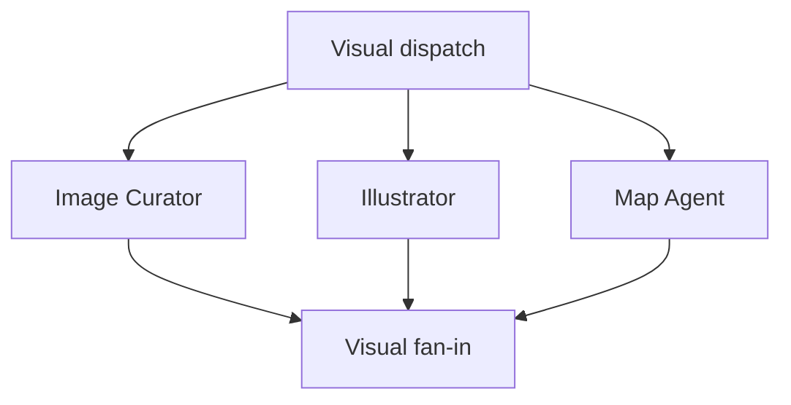

# Visual Team: tuần tự, rồi Send và fan-in

```powershell
python scripts/check_visual_team.py --mock
```

Lệnh chạy baseline tuần tự trước, xác nhận đủ kết quả rồi mới chạy song song.
Nếu baseline chưa đủ ảnh hoặc bị lỗi thì không tự chuyển sang bước song song.
Có thể chọn riêng --mode sequential hoặc --mode parallel sau khi đã kiểm tra.

--mock giả lập HTTP nhà cung cấp, dùng ảnh fixture và metadata ghi rõ MOCK;
ba lớp ImageCuratorAgent, IllustratorAgent, MapAgent, đồ thị LangGraph, thread,
SQLite, PNG và việc gộp kết quả đều chạy thật. Không coi kết quả mock là ảnh thật
hoặc bằng chứng giấy phép thực tế. production_approved luôn false.

Chạy API thật với các file upstream:

```powershell
python scripts/check_visual_team.py --mode both `
  --itinerary path/to/itinerary.json `
  --places path/to/research.json `
  --budget path/to/budget.json `
  --trip-request path/to/trip.json
```

Có thể thêm --weather path/to/weather.json. Dùng khóa/model/URL trong .env như
các CLI riêng của từng agent. Thiếu ảnh hoặc lỗi nhà cung cấp không được biến
thành complete giả; đọc visual_team.json để xem trạng thái từng nhánh.

## Cách phối hợp



Chế độ song song phát ba Send từ visual_dispatch. add_edge với danh sách cả
ba node tạo barrier cho visual_fan_in. Chế độ tuần tự dùng cùng agent và fan-in,
chỉ thay cạnh thành Curator -> Illustrator -> Map Agent -> fan-in.

Mỗi nhánh chạy trong worker thread và event loop riêng, tạo/đóng HTTP client
ngay trong thread đó. Vì thế bước render Matplotlib/Pillow không chặn event
loop của các nhánh đang gọi mạng. Một factory không nên trả lại client cũ đã
được sử dụng trên event loop khác.

Trước dispatch, coordinator kiểm tra phụ thuộc Content Editor, claim dự án bằng
một UPDATE có điều kiện để tránh hai lượt Visual Team chạy trùng cùng project.
File JSON được đọc/validate và chụp vào visual_inputs/<run_id>/. Cả ba nhánh dùng
đúng bản chụp này, kể cả khi State cũ giữ lịch trình khác. Fan-in kiểm tra hash
bản chụp không thay đổi trong lượt chạy.

## Tránh ghi đè khi song song

Các agent có tham số managed=True dành riêng cho coordinator. Khi đó agent vẫn
ghi task/sự kiện/artifact của chính nó, nhưng không lưu snapshot State chung,
không đổi trạng thái dự án và không tự mở Reviewer. Chạy standalone mặc định
managed=False, giữ hành vi các CLI riêng trước đây.

Nhánh chỉ trả một envelope visual_results[agent_id]. Reducer gộp ba key độc lập,
replay giống nhau là idempotent; replay mâu thuẫn bị từ chối. Fan-in mới áp dụng
các channel thuộc quyền mỗi nhánh:

| Agent | Channel gộp |
| --- | --- |
| Image Curator | photos, photo_warnings |
| Illustrator | illustrations, illustration_warnings |
| Map Agent | maps, charts, map_input_paths, map_warnings |

artifacts gộp theo ID, không mất file khi nhánh khác kết thúc. Kiểm tra project,
agent sở hữu, đường dẫn và file tồn tại trước khi nhận output. Khi cả ba báo
done, fan-in kiểm tra đủ một ảnh cho từng địa điểm, N+7 minh họa, N bản đồ và
ba biểu đồ. Node fan-in lưu State chung một lần rồi mới mở Reviewer.

Nếu một nhánh ném lỗi, vẫn thu kết quả của các nhánh còn lại. visual_complete
false, dự án failed; Reviewer không ready. Thiếu ảnh được xử lý thành
needs_attention. File ghi dở của nhánh lỗi có thể còn trong thư mục/DB để tra
cứu, nhưng không được tính là bộ output hoàn chỉnh của fan-in.

## Kết quả và chứng cứ

Mỗi chế độ tạo project riêng. Artifact của các agent nằm trong thư mục riêng
như trước. PM ghi pm/<run_id>/visual_team.json gồm:

- Trạng thái, dữ liệu trả về, thread ID và mốc perf_counter_ns của cả ba nhánh.
- all_three_overlap = max(started_ns) < min(ended_ns), số output, artifact IDs.
- input_files, input_hashes, complete và fan_in_count.

CLI xuất visual_team_validation.json ở project cuối, đối chiếu counts của hai
chế độ. Trong demo có barrier kiểm tra ba worker thực sự cùng được khởi động;
unit test dùng timeout để bắt trường hợp triển khai vô tình chạy tuần tự.
Thời gian trong demo có cache và độ trễ HTTP giả, không phải benchmark hiệu
năng production. Không bảo đảm mọi yêu cầu tới nhà cung cấp luôn chạy đồng thời
vì rate limit và công việc nội bộ từng agent có thể khác nhau.

Kiểm chứng: baseline và parallel đều gộp đủ 8 photos, 10 illustrations, 3 maps,
3 charts; sequential không chồng lấn cả ba, parallel có chồng lấn cả ba. Fan-in
thực thi đúng một lần sau ba sự kiện visual_branch_finished. Toàn bộ 162 kiểm
thử đạt, bao gồm lỗi một nhánh, thiếu ảnh và bảo vệ trạng thái Reviewer.

## API

```python
team = VisualTeam(db, settings)
result = await team.run(state, mode="parallel")
assert result["visual_complete"]
```

State cần project_id, trip_request và map_input_paths hoặc Artifact upstream
để tìm itinerary/research/budget/weather JSON theo quy tắc Map Agent. Task
Content Editor phải done. Graph con dùng VisualTeamState và trả các channel
chung kèm visual_results, visual_complete, visual_report để theo dõi.

Đây là phase dành cho ba agent thật, có thể gọi từ workflow thực. CLI toàn bộ
workflow fixture cũ vẫn giữ nguyên; chưa tự nối PM/Researcher/Planner/Budget/
Content Editor/Reviewer/Layout thật thành một pipeline production hoàn chỉnh.
